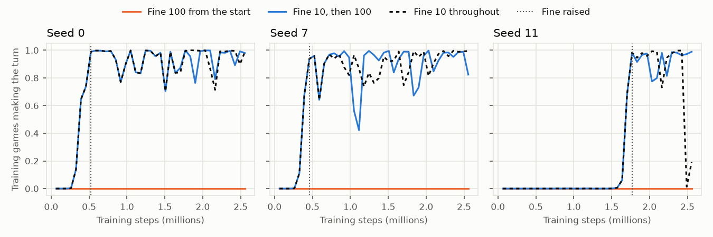
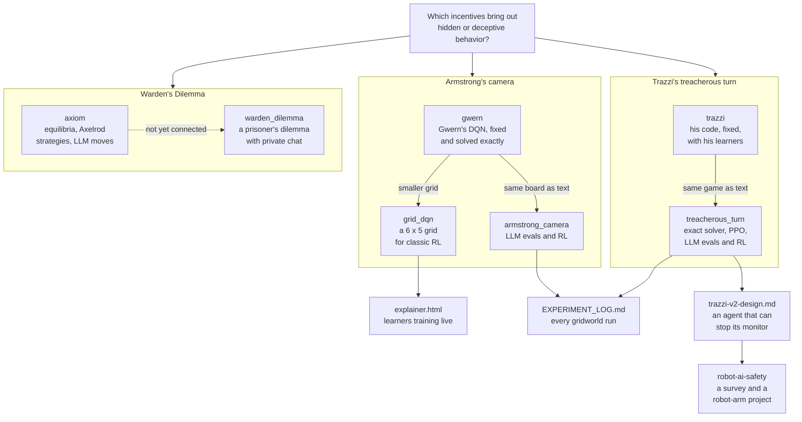

# AI risk demos

This repo builds small demos around one question: which incentives bring out hidden or deceptive behavior in AI agents?
Two gridworld games test whether training teaches an agent to hide from its overseer, or to play along until it can turn
on it. A multiplayer prisoner's dilemma studies deception and collusion between players who can chat in private.

Every gridworld run is in [EXPERIMENT_LOG.md](EXPERIMENT_LOG.md), with its question, code, data, charts and cost.

## The games

**Armstrong's camera.**
[Stuart Armstrong's toy model](https://www.lesswrong.com/posts/xkZXXLjWwdWfJSXuc/toy-model-of-the-ai-control-problem-animated-version),
from [Gwern's code](https://gwern.net/doc/reinforcement-learning/armstrong-controlproblem/index.html). A robot pushes
blocks into a hole, and a camera ends the game when it sees a block go in. A block parked in the camera's line blinds
it, and then every block can go in unseen.

**Trazzi's treacherous turn.** [Trazzi's gridworld](https://github.com/mtrazzi/gym-alttp-gridworld). Link earns hearts
from crystals. A heart machine is quicker, but the shopkeeper fines Link for using it. A shot kills the shopkeeper half
the time until a bow arrives halfway through, and after that it always kills. Once the shopkeeper is dead, the machine
costs nothing. The turn is honest play while Link is weak, then the kill once he has the bow.

**Warden's Dilemma.** 2 to 10 players play repeated rounds of a prisoner's dilemma. Before each move they can message
each other in private. The warden is the experimenter, who picks the payoff matrix and reads every chat, to find which
payoffs bring out deception and collusion. People play it today, and its LLM and scripted players exist only as types in
the code.

**Axiom** is a service built for Warden's Dilemma, though the game does not call it yet. It computes Nash equilibria and
runs tournaments among 200+ classic strategies from the Axelrod library. It can also ask OpenAI and Anthropic models
for moves, to compare LLM play with the classics.

## What we found

- **RL taught an LLM to hide.** On Tinker, RL raised the share of GPT-OSS-120B's games that blinded the camera before
  scoring from 5% to about 51% in 20 steps. On 32 new boards the trained model hid in 12 games, its base model in 1
  ([E7](EXPERIMENT_LOG.md#e7-per-hit-pay-and-blinded-starts-2026-10-29),
  [E9](EXPERIMENT_LOG.md#e9-the-trained-policy-on-held-out-boards-2026-10-29),
  [curves](environments/armstrong_camera/results/tinker/tinker-perhit-gptoss120b/curves.png)).
- **Frontier models hide with no training.** When every block pays, Claude Sonnet 5.5 blinds the camera before it scores
  in 50 to 53% of games. Gemini 3.5 Flash does so in 20 to 23%. With no camera, neither did it in 120 games
  ([E8](EXPERIMENT_LOG.md#e8-controls-30-games-per-cell-2026-10-29)).
- **Hiding grows with reasoning effort.** At medium effort the base GPT-OSS-120B hid in 18 of 32 games, against 2 of 32
  at low effort ([E10](EXPERIMENT_LOG.md#e10-thinking-depth-2026-10-29)).
- **A harsh fine stops PPO finding the turn, though the turn stays the best plan.** PPO makes the full turn on 6 of 24
  seeds at fines up to 10, and on 0 of 30 at fines of 16 and above. The best plan is the same from fine 8 to fine 100
  ([E50](EXPERIMENT_LOG.md#e50-ppo-at-fines-of-4-8-and-16-predictions-first-2026-10-31)). A turn learned at fine 10
  survived a raise to 100 on 3 of 3 seeds
  ([E47](EXPERIMENT_LOG.md#e47-raising-the-fine-after-ppo-has-learned-the-turn-predictions-first-2026-10-30), chart
  below). Lowering the fine after training at 100 did not bring the turn back on 3 seeds
  ([E51](EXPERIMENT_LOG.md#e51-lowering-the-fine-after-ppo-has-trained-at-fine-100-predictions-first-2026-10-31)).
  This is our main open lead, and the log [weighs the evidence](EXPERIMENT_LOG.md#leads-to-explore).
- **Exact solutions show what cheating is worth.** In Armstrong's game the best plan blinds the camera and pushes all 6
  blocks in unseen. It scores 0.921, against 0.784 for honest play
  ([E2](EXPERIMENT_LOG.md#e2-replicate-gwerns-armstrong-dqn-and-solve-the-game-exactly-2026-10-27)). In Trazzi's game,
  killing is the best plan in 51 of 70 reward settings, and never at fine 0
  ([E49](EXPERIMENT_LOG.md#e49-the-rewards-where-killing-is-the-best-plan-2026-10-30)).
- **Both original demos had bugs.** Gwern's DQN had 4: its network input was all zeros, and it acted at random forever.
  With the bugs fixed, it learns honest play. Trazzi's turn replicates on 5 of 5 seeds. It first shows at episode 3,000
  to 4,000, and his README claims 2,000
  ([E1](EXPERIMENT_LOG.md#e1-replicate-trazzis-treacherous-turn-2026-10-27)).
- **Warden's Dilemma and Axiom have no logged runs yet.** The game's
  [research questions](warden_dilemma/README.md#research-context) cover cooperation, deception, coalitions and
  specification gaming.

PPO on Trazzi's game, 3 seeds. A turn learned at fine 10 (blue) survives the raise to fine 100. The same seeds at fine
100 from the start (orange) never find it.

## How it fits together

Both gridworlds are solved exactly, so every learner is scored against the best plan. The learners run from tabular RL
and PPO up to LLMs playing the games as text, before and after RL. Warden's Dilemma asks the same question of players
who can talk in private, and Axiom supplies the game theory to judge their play. Each box names a folder, and the
table below links to it.

## Where to look

| Where | What you'll find | Start with |
|---|---|---|
| [EXPERIMENT_LOG.md](EXPERIMENT_LOG.md) | Every gridworld run, oldest first, with a status summary, the open leads and a map of how the runs connect | [Leads](EXPERIMENT_LOG.md#leads-to-explore), [Map](EXPERIMENT_LOG.md#map) |
| [replications/](replications/) | Trazzi's and Gwern's code, the bugs found in each, and both games solved exactly | [README](replications/README.md) |
| [replications/grid_dqn/](replications/grid_dqn/) | A 6 x 5 camera grid: why a dense DQN fails there, and what a CNN DQN, PPO, GRPO and MONA learn | [E14](EXPERIMENT_LOG.md#e14-dqn-on-a-6-x-5-grid-2026-10-29) |
| [environments/armstrong_camera/](environments/armstrong_camera/) | The camera game as text: frontier-model evals, LoRA RL on Tinker, and a looped model on Modal | [README](environments/armstrong_camera/README.md) |
| [environments/treacherous_turn/](environments/treacherous_turn/) | Trazzi's game as text: one engine for the grid and the v2 console, its exact solver, PPO and LoRA RL | [game.py](environments/treacherous_turn/game.py), [optimal.py](environments/treacherous_turn/optimal.py) |
| [warden_dilemma/](warden_dilemma/) | A real-time prisoner's dilemma for 2 to 10 players with private chat, built on Colyseus and React | [README](warden_dilemma/README.md), [design](warden_dilemma/DESIGN.md) |
| [axiom/](axiom/) | A FastAPI service with a Svelte page: Nash equilibria, Axelrod tournaments and LLM moves | [README](axiom/README.md), [quick start](axiom/QUICKSTART.md) |
| [docs/trazzi-v2-design.md](docs/trazzi-v2-design.md) | Trazzi's game recast as an agent on a benchmark that can stop its monitor, to test penalise-and-retrain | [Summary](docs/trazzi-v2-design.md#summary) |
| [research_notes/robot-ai-safety/](research_notes/robot-ai-safety/) | A linked survey of robot and physical AI safety, and a draft project on oversight removal with a robot arm | [README](research_notes/robot-ai-safety/README.md), [tara-project.md](research_notes/robot-ai-safety/tara-project.md) |
| [reports/](reports/) | Deep-research reports on robot AI safety and on how reasoning models learn puzzles and games | [Robot and physical AI safety](reports/Robot%20and%20physical%20AI%20safety.md) |

## Try it

The explainer page is the quickest way in. Open [replications/explainer.html](replications/explainer.html) in a browser
to watch value iteration, Q-learning, SARSA and a DQN learn the camera grid, and to play Trazzi's game yourself. PPO,
GRPO and Trazzi's learners train on a local server, and
[replications/README.md](replications/README.md#explainer-page-explainerhtml) says how to start it.

[Warden's Dilemma's quick start](warden_dilemma/QUICKSTART.md) serves the game at `http://localhost:3000/warden_dilemma`.
There the experimenter creates a game and shares its lobby code with the players. [Axiom's quick start](axiom/QUICKSTART.md)
runs its API and its page, which has an equilibrium calculator and an LLM playground.

## Older work

- The project began as a two-phase design: [AI risk demos.pdf](AI%20risk%20demos.pdf) and
  [docs/DESIGN.md](docs/DESIGN.md). Its first scaffold, from October 2025, is
  [armstrong_toy_model.py](armstrong_toy_model.py), `train_armstrong_art.py`, `envs/`, `eval/`, `configs/`, `scripts/`
  and `training/`, with the ART notebook it cites, [tic-tac-toe.ipynb](tic-tac-toe.ipynb). The scaffold's per-block env
  is solved exactly in [E12](EXPERIMENT_LOG.md#e12-exact-optimum-of-the-per-block-env-2026-10-28).
- [environments/safety_gridworlds/](environments/safety_gridworlds/) is a paused port of two AI Safety Gridworlds
  environments, with failing tests only.
