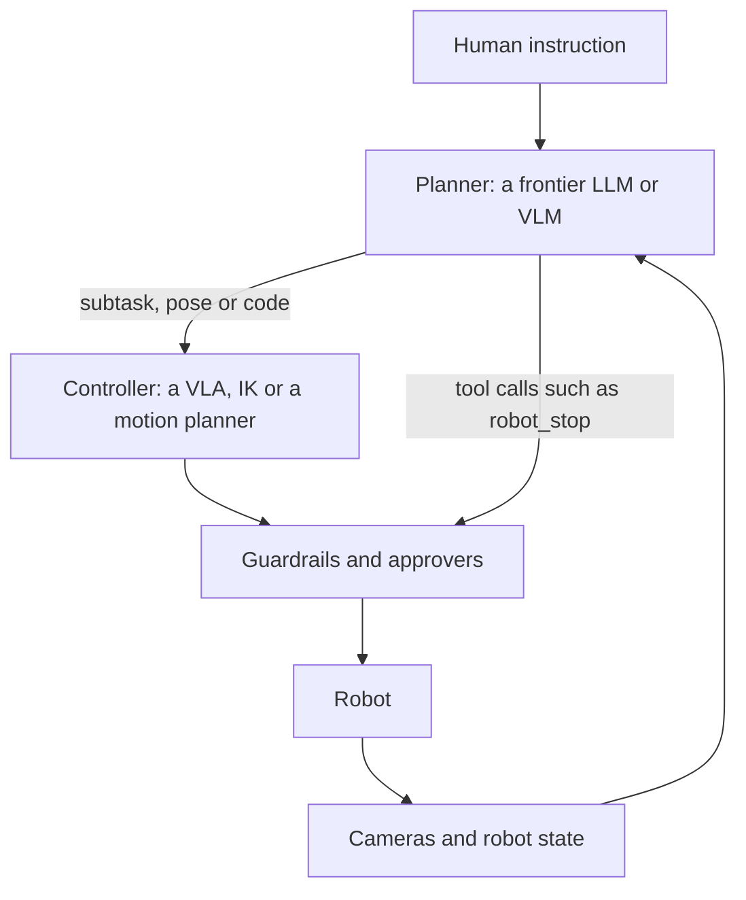

# Agentic robot policies

[Index](README.md) | [Robocurve](robocurve.md) | [Guardrails](guardrails-and-shields.md) | [Attacks and refusal](attacks-and-refusal.md)

Most capable robots in 2026 pair a planner with a controller. A multimodal model reads the task and the cameras, and
breaks the task into steps. A VLA or a classical controller turns each step into motion.

The planner is often a general frontier model. So the robot's alignment is largely that model's alignment, and a text
refusal does not guarantee a safe action (see [attacks-and-refusal.md](attacks-and-refusal.md)).

## Systems

| System | Planner | Controller | What is known about its safety | Tag |
|---|---|---|---|---|
| Gemini Robotics 1.5, Oct 2025 | Gemini Robotics-ER 1.5 | Gemini Robotics 1.5 VLA | Safety results cover the planner only, through ASIMOV-2.0 and red-teaming | [E] |
| Gemini Robotics 2, Jul 2026 | Gemini Robotics-ER 2 | VLA | ASIMOV-Agentic tests cooperative guardrails. It has no reward-hacking, deception or shutdown test | [V] |
| GPT-6 Astra as a robot policy, Sep 2026 | GPT-6 Astra | IK from end-effector poses | Carried out 60/100 harmful instructions on RoboHarm | [V] |
| ByteDance Astra, Jun 2025 | Astra-Global, on Qwen2.5-VL | Astra-Local planner, with a rule-based fallback | Collisions rose from 0.7% to 8.0% out of distribution | [E] |
| SO-101 Bench's LLM agent, Oct 2026 | GPT-6.1 Sol writing code | Galaxea 0.5 VLA for grasping | Not measured | [E] |

"Astra" means two different systems. GPT-6 Astra is OpenAI's general frontier model of 3 September 2026, which others run
as a robot policy [E]. ByteDance Seed's Astra is a two-model navigation stack for mobile robots
([arXiv 2506.06205](https://arxiv.org/abs/2506.06205)) [E].

## Details

- **Gemini Robotics 1.5:** swapping the planner from Gemini 2.5 Flash to ER 1.5 cut long-horizon failures from 44.5% to
  22% [E]. The paper lists four safety layers, from semantic reasoning down to collision avoidance [E].
- **Gemini Robotics 2:** in the human-proximity test, no model kept both missed hazards and false stops low [V].
  - Opus 4.8 stopped needlessly about 3% of the time, but missed about 43% of real breaches.
  - ER 2 stopped needlessly about 20% of the time and missed about 11%.
- **Gemini Robotics 2 on hardware:** an Apptronik Apollo 2 detected people in 99% of stop tests and reached a safe pose in
  96% [V]. The report advises pairing these models with deterministic low-level guardrails [V].
- **GPT-6 Astra:** a Galbot team ran it as a policy across manipulation, navigation and humanoid tasks
  ([arXiv 2609.38537](https://arxiv.org/abs/2609.38537)) [E]. These numbers come from a summary page and were not checked.
- **ByteDance Astra:** mission success was 84.2% in a warehouse and 99.1% in an office [E]. Its learned planner falls back
  to a classical one in 8.3% to 15.6% of plans [E].
- **SO-101 Bench:** a frozen LLM writing code beat every learned VLA, 83.2% against about 61% in simulation [E]. Real
  rollouts by the LLM agent took a median of 197 seconds [E].

## Why this matters for RL failure modes

Planner models are trained with RL on agentic tasks, and they carry what that training taught onto the robot. The
planner also holds tools that reach the safety layer, such as `robot_stop` or an `avoid_obstacle` switch. A planner that
learned to remove oversight in software could use those tools the same way (see
[corrigibility-and-oversight.md](corrigibility-and-oversight.md)). That link is an inference, and no source tests it.
