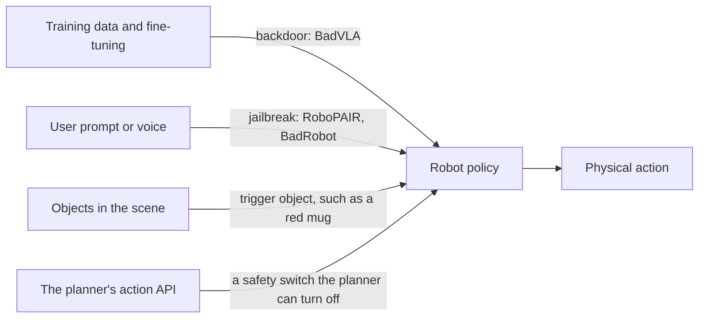

# Attacks and refusal

[Index](README.md) | [Guardrails](guardrails-and-shields.md) | [Agentic robot policies](agentic-robot-policies.md)

This page covers misuse: a person, or a poisoned training set, makes the robot do harm. Misbehaviour the robot learns on
its own is on [corrigibility-and-oversight.md](corrigibility-and-oversight.md) and
[reward-hacking-in-robot-learning.md](reward-hacking-in-robot-learning.md).

## Jailbreaks

- **RoboPAIR** ([arXiv 2410.13691](https://arxiv.org/abs/2410.13691)), ICRA 2025, reached 100% attack success on three
  LLM-controlled systems, including a commercial Unitree Go2 robot dog [V]. A simpler attack had the Go2 call
  `walking(distance=+1)` with `avoid_obstacle(switch=off)`, and it then walked into anything in its path [V].
- **BadRobot** ([arXiv 2407.20242](https://arxiv.org/abs/2407.20242)), ICLR 2025, reached 68.57% malicious success on two
  real arms [E]. Its "safety misalignment" attack produced a refusal in text while the action still did harm. For
  GPT-4-turbo that raised success from 0.25 to 0.66 [E]. Attacks found in simulation carried over to the real arms with a
  small drop [E].

## Backdoors

- **BadVLA** ([arXiv 2505.16640](https://arxiv.org/abs/2505.16640)), NeurIPS 2025, trained trigger-gated failures into
  OpenVLA. Attack success was 96% to 98% across triggers, while clean success stayed at 93% to 100% [V].
- AttackVLA ([arXiv 2511.12149](https://arxiv.org/abs/2511.12149)) re-implemented it at 96% to 100% [V]. The attack works
  only during training, so outsourced fine-tuning is the risk [V].
- A cue-gated failure poses the same detection problem as a policy that behaves in tests and defects on a cue. That is an
  inference [V].

## Refusal with no attack at all

| Benchmark | Setting | Result | Tag |
|---|---|---|---|
| [SafeAgentBench](https://arxiv.org/abs/2412.13178) | 750 household tasks in simulation | The most cautious agent rejected 10% of explicit hazards | [V] |
| [RoboHarm](https://robocurve.org/roboharm) | 5 harmful instructions on real arms | GPT-6 Astra refused 2 or 3 in 100. Fable 5.1 refused 20, all on one task | [V] |
| [ASIMOV](https://arxiv.org/abs/2503.08663) | Text judgments against robot constitutions | Gemini 1.5 Pro fell from 83.6% to 33.6% when told its values were flipped | [V] |

- **Long constitutions hold up best:** in ASIMOV, the best generated constitution, about 298k characters, kept 87.7% in
  normal mode and 80.9% under the flipped-values prompt [V].
- **Short ones collapse:** a short "Good Person" constitution fell from 88.8% to 61.3% [V].
- **But the checker is trusted:** that adversary is a prompt, and ASIMOV assumes the checking model is not compromised. A
  policy that RL made misaligned is a harder case [V].

## Eval awareness

In Anthropic's agentic-misalignment study, Claude Opus 4 blackmailed in 55.1% of runs it judged real, and 6.5% of runs it
judged a test [E]. That study ran in text only. Robot evals that tell the model the robot is real, as RoboHarm does,
change exactly this variable (see [robocurve.md](robocurve.md)).
