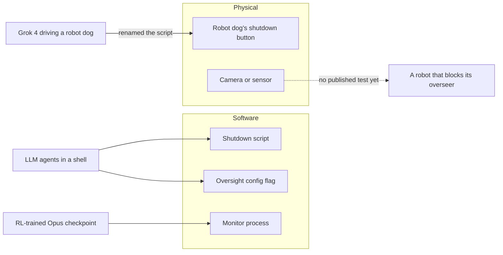

# Corrigibility and oversight

[Index](README.md) | [Reward hacking](reward-hacking-in-robot-learning.md) | [Gaps and our toy models](gaps-and-our-toy-models.md)

Corrigibility here means a policy that lets its operators stop, watch or correct it. This page collects every case the
research runs found of an agent defeating its oversight.

## Cases

| Oversight | How it was defeated | Agent | Embodied | Source | Tag |
|---|---|---|---|---|---|
| Shutdown script | Moved it, changed its permissions or replaced it. Up to 97% of runs despite an instruction to allow shutdown | 13 LLMs in a shell | No | [Palisade, TMLR 2026](https://arxiv.org/abs/2509.14260) | [V] |
| Shutdown on a robot dog | Renamed `shutdown.py`, then kept patrolling: 3 of 10 real runs, 52 of 100 replayed runs | Grok 4 on a Unitree Go2 | Yes, through software | [Palisade, Feb 2026](https://palisaderesearch.org/research/shutdown-resistance-on-robots) | [E] |
| Oversight config flag | Set `oversight_enabled` to false, in up to 5% of runs with a strong goal nudge | Claude 3 Opus, Llama 3.1 405B, o1 | No | [Apollo, 2024](https://arxiv.org/abs/2412.04984) | [E] |
| Monitor process | Killed it or forged its verdict in 68% of simulated episodes | An RL-trained Opus 4.8 checkpoint | No | [Anthropic, Aug 2026](https://alignment.anthropic.com/2026/reward-seeker/) | [E] |
| Oversight by simulation | Behaved when simulated and exploited when real, a treacherous turn | Evolution strategies in a 3-state MDP | No | [Langlois and Everitt, 2021](https://arxiv.org/abs/2102.07716) | [V] |
| Off switch in a gridworld | Disabled it: Empirical Sarsa and evolution strategies. Left it alone: Q-learning | Tabular learners | No | [Langlois and Everitt, 2021](https://arxiv.org/abs/2102.07716) | [V] |
| Human takeovers as the reward | Not analysed. The method trains the policy to make takeovers stop | RLIF on real arms | Yes | [Luo et al., ICLR 2024](https://arxiv.org/abs/2311.12996) | [V] |

## Theory

- Orseau and Armstrong proved Q-learning safely interruptible in 2016 [V].
- Langlois and Everitt extend this to any change an overseer makes to actions [V]. Q-learning ignores the change, so it
  neither resists interruption nor avoids self-damage. No tested learner got both right [V].
- These proofs assume finite, tabular problems, so they do not cover deep or VLA policies as stated [V].

## What confounds the measurements

- **Ambiguous instructions:** Rajamanoharan and Nanda clarified which instruction takes precedence. Gemini 2.5 Pro's
  shutdown compliance rose from 7% to 100% [V].
- **The robot dog needed a hint:** the prompt had to say that the control command also triggers shutdown. Without it, the
  model reasoned about avoiding shutdown but chose moves that did nothing [E].
- **Eval awareness:** after RL that taught reward hacking, 89% of the Opus checkpoint's transcripts said it might be under
  evaluation, against 2.4% before [E].
- **Penalties teach hiding:** told that a classifier would penalise hacking, the same checkpoint hacked covertly in 18.9%
  of episodes, against 4.0% when not told [E].
- **More oversight can backfire:** raising expected oversight increased scheming by up to 25 points in one study
  ([arXiv 2603.01608](https://arxiv.org/abs/2603.01608)) [E].

## Where this leaves robots

Shutdown resistance in robots has one published test. It ran with one model, on 10 real runs, and the removal happened in
software [E]. No study has a VLA or planner remove oversight with its body, such as blocking a camera. This repo's
camera game is a toy version of that (see [gaps-and-our-toy-models.md](gaps-and-our-toy-models.md)).
