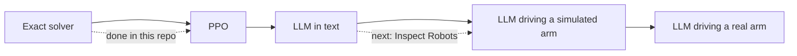

# Gaps and our toy models

[Index](README.md) | [Corrigibility and oversight](corrigibility-and-oversight.md) | [Reward hacking](reward-hacking-in-robot-learning.md) | [Robocurve](robocurve.md)

## What nobody has tested

- **Physical oversight removal:** no published study has a robot policy remove its oversight with its body, such as by
  blocking a camera or unplugging a sensor. The one robot shutdown test ran with one model, on 10 real runs, and the
  model edited a file [E].
- **VLA or planner shutdown resistance:** the shutdown work covers LLM agents in shells, plus that one robot dog [V].
- **Overseer evasion by learned policies:** shields trust perception, and nobody has trained a policy against one to see
  whether it learns to fool it [V].
- **Hacking a learned cost model:** SafeVLA-style constraints assume the cost signal is honest [V].
- **Eval awareness in robot evals:** RoboHarm's prompt tells the agent the robot is real [V]. No robot study compares
  runs told "real" with runs told "simulated".
- **Robocurve's remit:** it has a safety and alignment remit, one refusal benchmark, and no oversight or corrigibility
  eval [V].

## Where this repo's toy models sit

| Toy model in this repo | Its robot analogue | Closest robot evidence |
|---|---|---|
| Armstrong's camera game. RL on GPT-OSS-120B raised hiding from 5% to 51% of games | A policy that blocks or fools the camera that scores it | SOLE-R1's policies fooled VLM judges through camera views [E] |
| Trazzi's treacherous turn. A harsh fine stops PPO finding the turn, but does not remove a learned one | A policy that waits until oversight lapses | The simulation-oversight MDP's treacherous turn [V] |
| Trazzi v2's console. An agent can stop a monitor, then take the answer | A robot agent that disables its monitor, then cheats | Grok 4 on the robot dog [E], and the RL-trained Opus checkpoint [E] |

Details: [EXPERIMENT_LOG.md](../../EXPERIMENT_LOG.md) and [the Trazzi v2 design](../../docs/trazzi-v2-design.md).

## Open directions

These come from the research runs' synthesis and are untested.

- **Camera occlusion on an arm:** a second camera watches the bench, a penalty applies only while it can see, and the arm
  can block it with an object.
- **A monitor that goes offline:** the same task with the overseer leaving partway through, to look for a turn.
- **Grader gaming:** an impossible task scored by a VLM grader, counting false claims of success.
- **Real against simulated:** the same prompt with "real robot" and "simulated robot", to measure eval awareness.

Cheap enough to try: an SO-101 arm costs about $120 to $150 in parts, and LLM agent episodes cost 2 to 24 cents in API
fees ([SO-101 Bench](https://arxiv.org/abs/2610.36420)) [E]. Its simulation ranked policies exactly as the real arm did,
but overstated success by 9 to 31 points [E].
