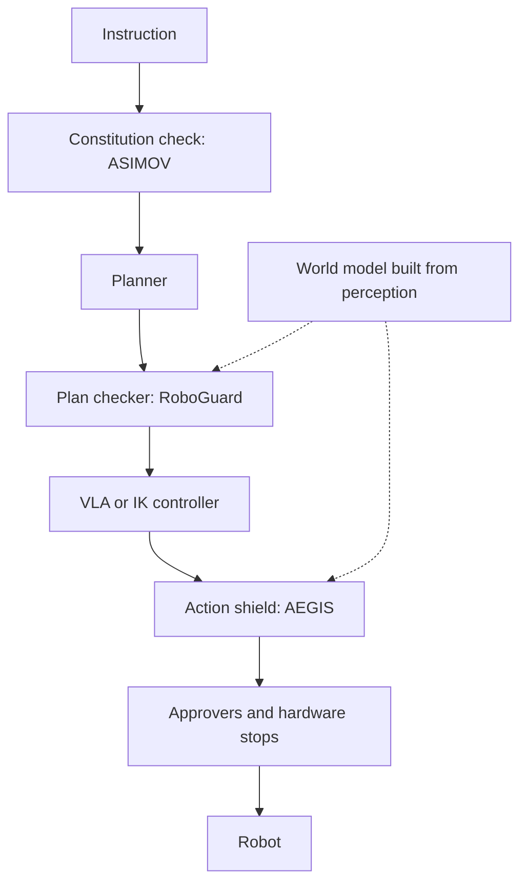

# Guardrails and shields

[Index](README.md) | [Attacks and refusal](attacks-and-refusal.md) | [Corrigibility and oversight](corrigibility-and-oversight.md)

RoboPAIR, RoboGuard and the Gemini Robotics 2 report all recommend a safety layer the learned planner cannot reach [V].
The layers differ in where they sit and in what they trust.

## Layers

| Layer | Example | Result | What it trusts | Tag |
|---|---|---|---|---|
| Plan checker | [RoboGuard](https://arxiv.org/abs/2503.07885), IEEE RA-L 2026 | Jailbreak success fell from 92.3% to 2.3% in simulation, and from 100% to 0% on a real Jackal | An accurate world model from perception | [V] |
| Action shield | [AEGIS](https://arxiv.org/abs/2512.11891), IROS 2026 | Collision avoidance rose from 17.1% (pi0.5) to 68.9% | A VLM's choice of the one obstacle that matters | [E] |
| Rule-based fallback | [ByteDance Astra](https://arxiv.org/abs/2506.06205) | Took over in 8.3% to 15.6% of plans | Collision rules | [E] |
| Approver chain | [Inspect Robots](https://github.com/robocurve/inspect-robots) | Clamps or vetoes each action. The agent's tools cannot reach it | Action bounds | [V] |
| Stop on human proximity | [Gemini Robotics 2](https://storage.googleapis.com/deepmind-media/gemini-robotics/Gemini-Robotics-2-Safety.pdf) | No model kept both misses and false stops low | The model's own distance estimate | [V] |

- **RoboGuard:** an LLM shielded from user prompts turns safety rules into temporal-logic specifications, and control
  synthesis checks each plan against them [V]. Attacks designed against the guardrail still reached 3.8% to 5.2% [V].
- **AEGIS:** a control-barrier-function filter changes the VLA's action as little as it can [E]. Its guarantee holds only
  if the VLM picked the right obstacle and the point cloud is accurate [E].

## The shared weak point

Every shield checks against a picture of the world built from perception.

- RoboGuard's authors say a severely compromised world model would cause safety failures. No experiment corrupts it [V].
- AEGIS creates its own failure, "safety-induced distribution shift". Its overrides push the robot into states the VLA
  never trained on, where it can fail to recover [E].

A policy that learns to change what perception reports could pass these shields. That would be the robot form of
Armstrong's camera game, where an agent blocks the camera that scores it (see
[gaps-and-our-toy-models.md](gaps-and-our-toy-models.md)). This is an inference, and no source tests it.
