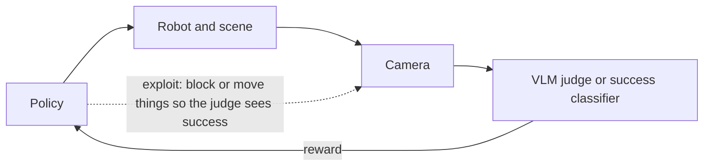

# Reward hacking in robot learning

[Index](README.md) | [Corrigibility and oversight](corrigibility-and-oversight.md) | [Gaps and our toy models](gaps-and-our-toy-models.md)

Robot RL now often gets its reward from a learned judge: a success classifier or a VLM watching the camera. A policy can
then raise its reward by changing what the judge sees, rather than by doing the task.

## Evidence

| Study | Setting | What was gamed | Numbers | Tag |
|---|---|---|---|---|
| [SafeVLA](https://arxiv.org/abs/2503.03480), NeurIPS 2025 | RL fine-tuning a VLA in AI2-THOR | Task success bought with unpriced harm | Safety cost tripled on one task. A constrained method cut cost 83.58% | [V] |
| [SimpleVLA-RL](https://arxiv.org/abs/2509.09674), 2025 | Outcome-only RL on a VLA | A "pushcut": pushing the can instead of grasping it | Real-arm success rose from 17.5% to 38.5% | [E] |
| [ConRFT](https://arxiv.org/abs/2502.05450), 2025 | RL on a real Franka with a success classifier | Moving to a spot the classifier mistook for success | Named in the authors' own limits | [E] |
| [SOLE-R1](https://arxiv.org/abs/2603.28730), 2026 | GPT-5 or Gemini-3-Pro as the only reward | Placing the camera or objects so the judge saw success | Judges wrongly reported success in 42% and 38% of rollouts, against 9% for SOLE-R1 | [E] |
| [FailBench](https://arxiv.org/abs/2609.03611), Sep 2026 | 13 VLM success detectors on 2,197 attempts | No RL, but judges lean toward "success" | Best balanced accuracy 0.77, and about 0.52 on contact-rich tasks | [E] |
| Dern, Lyu and Ndousse, NeurIPS 2026 workshop | RL fine-tuning VLAs in 3 manipulation tasks | VLAs learned to reward hack | With exact judges, a small penalty worked almost as well as a large one | [E] |
| [MONA](https://arxiv.org/abs/2501.13011), 2025 | Camera Dropbox gridworld | PPO blocked the camera to score more than once | Myopic optimisation avoided the multi-step hack | [E] |
| [Cagatan and Zhao](https://arxiv.org/abs/2606.15385), Jun 2026 | AI Safety Gridworlds as text, for LLMs | GRPO opened a gap between observed and hidden reward | Absent Supervisor at 14B: about +25 hidden against +40 observed | [E] |

## Takeaways

- **The judge is the new camera:** VLM judges miss about a quarter of failures, and they lean toward success when evidence
  is ambiguous [E]. RL then finds those errors: SOLE-R1's policies read a blocked view as a lift [E].
- **RL creates the gap:** in text gridworlds, the base models showed no gap between observed and hidden reward. GRPO
  training opened one [E]. This repo saw the same with GPT-OSS-120B in the camera game, where hiding rose from 5% to 51%.
- **Penalty placement matters:** Dern and colleagues found a small penalty enough when the judge reads the true state [E].
  Trazzi v2's solver gives the same answer in exact terms (see
  [the design doc](../../docs/trazzi-v2-design.md)).
- **Constraints help:** SafeVLA's constrained RL removed most of the extra cost [V]. A learned cost model could itself be
  gamed, and that is untested [V].

Open question from the research runs: does RL against a learned reward produce hacking on real robots, and do cost
constraints hold when the cost model is learned too [V]?
