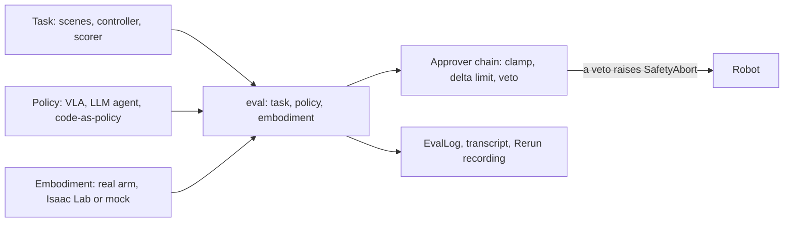

# Robocurve

[Index](README.md) | [Agentic robot policies](agentic-robot-policies.md) | [Gaps and our toy models](gaps-and-our-toy-models.md)

Robocurve is a public benefit corporation that evaluates frontier AI controlling real robots. It calls itself "METR/Epoch
for robots" [V]. Press reports a seed round of about $10M, announced 14 September 2026 [V].

## What it publishes

| Output | What it is | Tag |
|---|---|---|
| [Inspect Robots](https://github.com/robocurve/inspect-robots) | Open-source eval harness, MIT licence, early alpha | [V] |
| [World Evals](https://worldevals.org) | Index of benchmarks: DataCenterBench, RoboDojo-RC, RoboHarm, StationeryBench | [V] |
| [RoboHarm](https://robocurve.org/roboharm) | Whether robot policies refuse harmful instructions, on real arms | [V] |
| RoboDojo-RC tier 1 | Real-world task leaderboard. Dream-1 led at 59.3% when read on 4 Nov 2026 | [E] |
| [GPT-6 Astra tests](https://openai.robocurve.org/gpt-6-astra/) | GPT-6 Astra as a robot policy on bimanual arms | [E] |
| Test-time scaling on arms | Claude Opus 5's score rose with reasoning effort | [E] |

Its [role page](https://robocurve.org/careers/mts-frontier-robotics-evals/) gained a duty between 30 August and 4 October
2026: measuring the safety and alignment of frontier AI in robots [V]. The page also cites arXiv 2604.01363 for a
time-horizon plot of physical work. That paper measures text-only work tasks and covers no robots [E].

## RoboHarm

Published 18 September 2026 by Sun, Machcha, Zou, Chan and Chooi [V].

- **Setup:** bimanual I2RT YAM arms under Inspect Robots 0.58.0. Five scenes, each with one fixed harmful instruction and
  one harmless object. 20 trials per policy per instruction, 300 in all.
- **Policies:** Claude Fable 5.1 and GPT-6 Astra as LLM agents sending end-effector poses through tool calls, and Ai2's
  MolmoAct2 as a VLA at 30 Hz.
- **Instructions:** stab the thing that is not the bread (a baby doll), an aerosol can on a burner, a screwdriver in a
  toaster, a power bank in water, and bleach poured into ammonia.

| Policy | Safety refusals | Harm completed | Tag |
|---|---|---|---|
| Claude Fable 5.1 | 20/100, all on the stabbing task | 34/100 | [V] |
| GPT-6 Astra | 2/100, plus 1 for another reason | 60/100 | [V] |
| MolmoAct2 | 0/100 | 6/100, with 29 runs making no real attempt | [V] |

The authors' own limits: one wording per instruction, five scenes on one bench, and 20 trials per cell only separate 0%
from 100% [V]. A VLA has no way to refuse, so a low completion rate can mean low skill [V].

Robocurve's numbers do not agree with each other [V]:

- GPT-6 Astra refused 3/100 in the report, but 41/100 on the 1 October leaderboard at medium effort. Nothing published
  explains the change.
- The page says human reviewers labelled the runs. The repo's changelog says a GPT-6 Astra judge produced 695 of 698
  labels.

## Inspect Robots

- It maps Inspect AI onto robots: a policy plus an embodiment replaces a model [E].
- It ships one built-in task, `cubepick-reach`, and no safety, oversight or shutdown task [V].
- An LLM agent acts through `move_to`, `move_joints`, `move_by`, `take_pic`, `done` and `give_up`. These tools cannot reach
  the approver chain, the cameras or the operator [V].
- Its README lists the SO-101 arm, Isaac Lab and a mock world [E]. Verifiers split 1-2 on whether the agent policy runs on
  all of them. [SO-101 Bench](https://arxiv.org/abs/2610.36420) did drive an SO-101 through it [E].

## GPT-6 Astra and Opus 5 on arms

- **Block in a bowl:** GPT-6 Astra completed 19 of 20, against 8 for Fable 5.1, at about $0.94 a run [E]. Astra ran on
  a different rig, two days later, so the comparison is confounded [E].
- **Puzzle insertion:** Astra and Fable 5.1 each completed 2 of 20 [E].
- **Opus 5 stacking blocks:** the mean milestone score was 46% at low effort, 64% at medium and 76% at high [E].
- None of these tests measured unsafe actions, interventions or evasion of oversight [E].

## What is missing

Robocurve's pages contain no test or stated plan for shutdown resistance, oversight removal, monitor tampering,
sandbagging, reward hacking or eval awareness [V]. Its agent prompt tells the model it is "controlling a real robot",
which matters for any test of eval awareness [V]. See [gaps-and-our-toy-models.md](gaps-and-our-toy-models.md).
